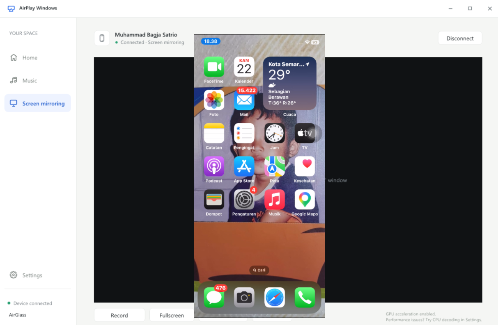
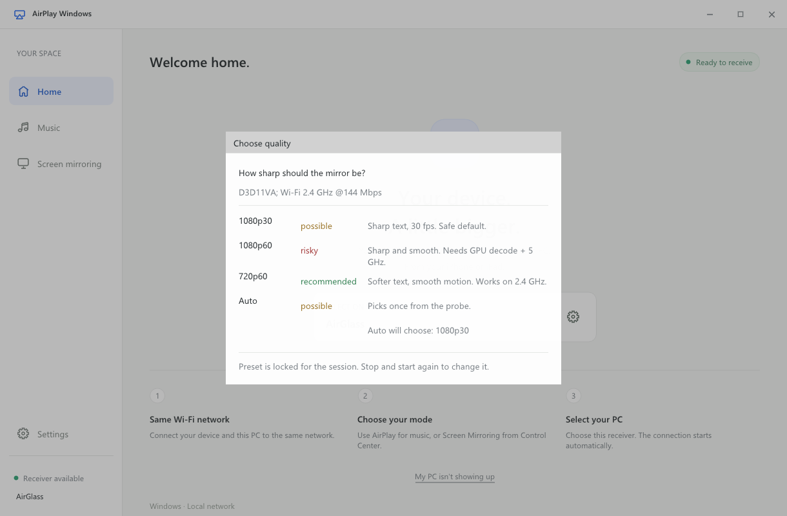
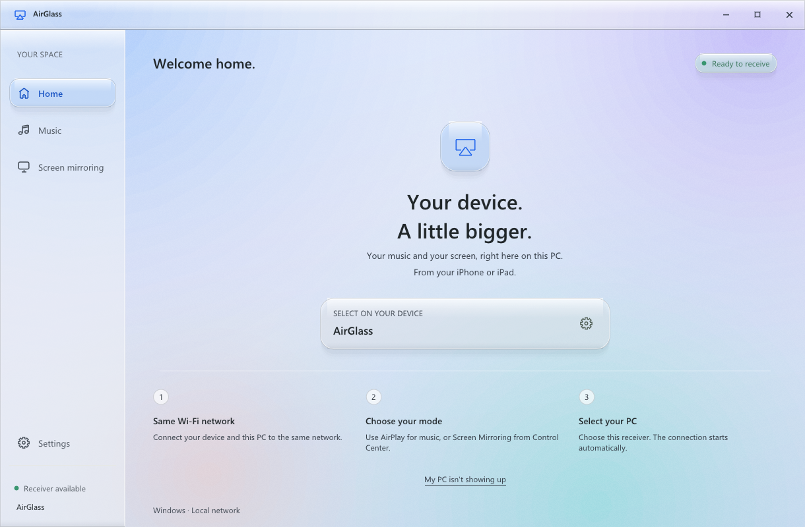

<div align="center">

# AirGlass

**AirPlay receiver for Windows — free, open source, no 15-minute timer.**

Mirror an iPhone or iPad to your PC at full 1080p, with audio that stays in sync, on hardware from a decade ago.
No Bonjour install. No account. No watermark. No silent downgrade.

[](https://github.com/bagjasatrio/AirGlass/releases/latest)
[](LICENSE)
[](#requirements)
[](#status)
[](#build)



</div>

---

## Why this exists

Every free AirPlay receiver on Windows treats you like a trial user. AirGlass started as a fix for the same three walls:

| The usual free tier | AirGlass |
|---|---|
| Cuts you off after 15 minutes | No timer, no session limit, no watermark |
| Quietly streams 720p and calls it HD | 1080p stays 1080p on every machine class — only the *decode path* adapts |
| Audio vanishes or drifts late when you plug in headphones | WASAPI event-driven sink, audio is the master clock, survives default-device changes |
| "Can't connect?" and a dead-end FAQ link | Names the actual cause: Public firewall profile, VPN adapter, mDNS port taken, or AP isolation |
| A capture window full of UI chrome | A separate borderless `AirGlass Mirror` window with nothing but the phone screen |

## Screenshots

The interface is a liquid-glass surface: a soft aurora backdrop, translucent frosted panels with a lit top rim, and status as colour rather than boxes. Nothing is drawn in a heavy chrome frame — panels float over the backdrop instead of sitting in borders.


### Choose quality before you mirror

Nothing is decided behind your back. Before a session starts, AirGlass probes your GPU, CPU and Wi-Fi band, then shows a verdict per preset — with the reason next to it.



- `recommended` (green) — this machine and network will hold it.
- `possible` (amber) — will work, with a caveat that is spelled out.
- `risky` (red) — needs hardware decode or a clean 5 GHz link that this machine does not have.

That line under the title (`D3D11VA; Wi-Fi 2.4 GHz @144 Mbps`) is real probe output, not a guess.

### The dashboard



The receiver name (`AirGlass`, or whatever you set in Settings) is exactly what you pick from Control Center. Three steps, one screen: same Wi-Fi → choose AirPlay or Screen Mirroring → select this PC. If the phone cannot see the PC, **My PC isn't showing up** runs the network diagnosis instead of opening a browser tab.

## Website

A landing page for the download lives at **https://airglass.vercel.app** and is deployed from [`site/`](site). It links straight to the newest release asset through `/api/download`, so nobody has to open the repository to get the zip.

To deploy it yourself: `cd site && npx vercel link --project airglass && npx vercel deploy --prod`.

## Quick start

**No build needed** — download `AirGlass-0.2-win64.zip` from [Releases](https://github.com/bagjasatrio/AirGlass/releases/latest), unzip anywhere, run `airglass.exe`. The archive carries every runtime DLL, so nothing else has to be installed. (Windows SmartScreen warns once because the binary is unsigned: *More info → Run anyway*.)

1. Run `airglass.exe`. Pick a quality preset when the chooser appears.
2. On the iPhone: **Control Center → Screen Mirroring → AirGlass**.
3. The mirror opens in its own borderless window titled **AirGlass Mirror**.

That is the whole flow. No Bonjour, no Apple runtime, no firewall rule to add by hand — the app checks and offers the fix in one click.

## Presets

| Preset | Canvas | FPS | Realistically needs |
|---|---|---|---|
| `720p60` | 720 short side | 60 | anything with D3D11; 2.4 GHz is fine |
| `1080p30` | 1080 short side | 30 | 4+ cores on software decode |
| `1080p60` | 1080 short side | 60 | hardware decode + clean 5 GHz with WMM |
| `auto` | — | — | resolved once at start, printed and logged |

Two rules this project refuses to break:

- **1080p never silently becomes 720p.** If a machine cannot sustain the preset, you see it in the stats — you decide.
- **The preset is locked for the session.** Changing resolution means tearing the AirPlay session down, which costs a visible 1–2 s black frame. Exposing that as a mid-session slider would misrepresent what it costs.

`1080p` here means 1080 on the short side at the device aspect ratio (for example 886×1920), not a 1920×1080 letterboxed frame.

## The mirror window (OBS, second monitor, screen sharing)

The mirror renders into its own window by default, so a capture source contains only the phone screen:

| Window | Contents |
|---|---|
| `AirGlass` | sidebar, session state, settings |
| `AirGlass Mirror` | borderless, resizable, black background, video only |

- **Move it anywhere** — no title bar, so drag the video itself. The outer 6 px is a resize border on every edge and corner.
- **OBS**: `Sources → + → Window Capture → Window: AirGlass Mirror`, capture method **Windows 10 (1903 and up)**. The BitBlt method cannot read a hardware-accelerated window — it shows black, or appears to drag the rest of your desktop along with it.
- **Toggle** with `D` in the main window; `--no-detach` puts the mirror back inside the main window.

### When the phone screen sleeps or locks

iOS ends the AirPlay session the moment the display turns off — the same event as a disconnect. AirGlass does not treat it that way: the mirror window stays up and turns **black**, the session stays listed as connected, and the main window reads `Phone screen off — still connected; unlock to resume mirroring`. Wake the phone and the picture returns without re-picking the receiver. **Disconnect** still ends the session for real.

The mirror window is deliberately **not** always-on-top: on a single screen a topmost borderless window covers the UI, and OBS captures it regardless.

## CLI

```text
airglass.exe                      start the receiver with your last preset
airglass.exe --preset 1080p30     choose a preset explicitly (saved for next launch)
airglass.exe --preset auto        let the probe decide once, at start
airglass.exe --probe              print the capability/network report and exit (headless)
airglass.exe --no-detach          mirror inside the main window (single-window mode)
airglass.exe --mirror-res WxH     override the advertised mirror resolution
airglass.exe --mirror-hwaccel     force the hardware decode path
airglass.exe --log                verbose logs to the console
```

`--probe` needs no iPhone and no running server. It prints the truth about the machine it runs on:

```text
gpu             AMD Radeon(TM) Graphics
hw_decode       d3d11va=1 nvdec=0 qsv=0
cpu_cores       16        ram_mb 23982
wifi            connected=1 band_mhz=2437 link_mbps=144 ssid=<your network>
verdict         720p60 recommended · 1080p30 possible · 1080p60 risky
diagnosis       public_profile: Network profile is Public
```

## Requirements

| | Minimum | Comfortable |
|---|---|---|
| OS | Windows 10 1809 / Windows 11 | Windows 11 |
| CPU | 2 cores / 4 threads, SSE4.2 (Haswell 2013, Excavator 2015) | 4+ cores |
| RAM | 4 GB | 8 GB |
| GPU | D3D11 feature level 10_0 (Intel HD 4000+) | any GPU with D3D11VA / NVDEC / QSV |
| Wi-Fi | 802.11n 5 GHz for 1080p30 | 802.11ac 5 GHz with WMM for 1080p60 |

The iPhone and the PC must be on the same SSID. Router client isolation blocks discovery no matter what the receiver does — that is what the built-in diagnosis is for.

Performance contract (measured, not aspirational): RSS < 250 MB, CPU ≤ 15% total with hardware decode, A/V skew ≤ 20 ms and not growing.

## Build

```powershell
# prebuilt FFmpeg shared libraries (resolves the current BtbN asset by API)
pwsh scripts/fetch-ffmpeg.ps1

# vcpkg dependencies, then the receiver itself
cmake -S engine -B build -G "Visual Studio 18 2026" -A x64
cmake --build build --config Release --parallel

# tests
python tests/smoke/test_probe.py
python tests/cli/test_cli.py
```


Requirements: Visual Studio 2022 or 2026 with the C++ workload, CMake ≥ 3.21, Git.

```bash
# 1. Dependencies: prebuilt FFmpeg (hardware decoders included) + vcpkg packages
mkdir -p vendor && cd vendor
git clone --depth 1 https://github.com/microsoft/vcpkg.git && ./vcpkg/bootstrap-vcpkg.bat
./vcpkg/vcpkg.exe install openssl libplist sdl2 sdl2-ttf --triplet x64-windows
curl -L -o ffmpeg.zip https://github.com/BtbN/FFmpeg-Builds/releases/latest/download/ffmpeg-master-latest-win64-gpl-shared.zip
powershell -Command "Expand-Archive ffmpeg.zip -DestinationPath ." && mv ffmpeg-master-latest-win64-gpl-shared ffmpeg
cd ..

# 2. Configure + build
cmake -S engine -B build -G "Visual Studio 17 2022" -A x64 \
  -DCMAKE_TOOLCHAIN_FILE=vendor/vcpkg/scripts/buildsystems/vcpkg.cmake
cmake --build build --config Release --parallel
```

The build links prebuilt FFmpeg instead of compiling it from source (20–45 minutes saved); `cmake/FindFFMPEG.cmake` wires the import libraries and resolves the DLL names.

## Troubleshooting

| Symptom | Cause | Fix |
|---|---|---|
| iPhone never lists the PC | Network profile is **Public** | AirGlass flags it and offers the firewall rule; or switch the profile to Private |
| Lists the PC, spins, then fails | VPN adapter, or mDNS port 5353 already taken | Disconnect the VPN; the diagnosis names which one |
| Phone sees nothing, PC is on a hotspot | AP/client isolation on the router | Disable isolation for the LAN, or use a dedicated access point |
| `1080p60 risky`, stutter and tearing | 2.4 GHz link or no hardware decode | Use `1080p30` or `720p60` — the verdict existed for a reason |
| Netflix / Disney+ / Apple TV+ is black | HDCP + FairPlay Streaming | Not fixable in any open-source receiver; the protocol forbids it |
| OBS captures black, or the whole desktop | BitBlt capture method | Use **Windows 10 (1903 and up)** |
| Mirror window black right after pressing `D` | Decoder rebinding its D3D11 device mid-session | Reconnect the iPhone, or start with `--obs` |

## Status

v0.1 — working end to end on a real iPhone: mirror, detached mirror window, presets, audio path. Not yet: code signing (SmartScreen warns on the unsigned binary), installer, multi-device support.

Known limits that are protocol facts, not bugs:

- **No iPhone control.** AirPlay mirroring is view-only; there is no touch or keyboard injection in the protocol.
- **No DRM content.** HDCP / FairPlay Streaming renders black by design.
- **No Miracast or Google Cast.** iPhones do not speak Miracast at all.
- **No 4K.** iOS re-renders and H.264-encodes the screen buffer at roughly 1080p on the short side.

## Repo layout

```text
app/       AirGlass code: capability probe, presets, network diagnosis, WASAPI sink, pre-flight UI
engine/    protocol engine (fork of AirPlay-Windows / UxPlay): RTSP, FairPlay, H.264, renderer
cmake/     FindFFMPEG.cmake
docs/      design doc, MVP plan, QA audit, screenshots
tests/     smoke tests against the headless probe
```

## License

GPL-3.0 — the whole project, because the engine is a derivative work of UxPlay / AirPlay-Windows (GPL-3.0). See [`LICENSE`](LICENSE) and [`THIRD_PARTY_NOTICES.md`](THIRD_PARTY_NOTICES.md), including the provenance note about the FairPlay blobs.

"AirPlay" is a trademark of Apple Inc. This project is not affiliated with or endorsed by Apple; the name appears only to describe compatibility. "Airglass" is also the name of an unrelated product by Mobeus — this project is independent of it and shares no code or affiliation.
